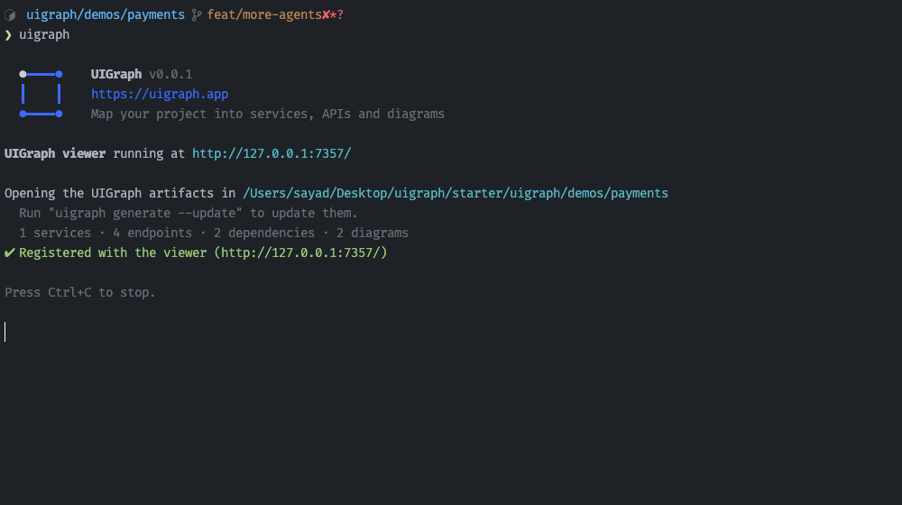

<p align="center">
  
</p>
<h1 align="center">UIGraph</h1>
<h3 align="center">Map your project into services, APIs and diagrams.</h3>

<p align="center">
  <a href="#install"><strong>Install</strong></a> &nbsp;·&nbsp;
  <a href="#quick-start"><strong>Quick start</strong></a> &nbsp;·&nbsp;
  <a href="#use-the-uigraph-skill"><strong>Skill</strong></a> &nbsp;·&nbsp;
  <a href="#commands"><strong>Commands</strong></a> &nbsp;·&nbsp;
  <a href="#lens"><strong>Lens</strong></a>
</p>

<p align="center">
  <a href="https://www.npmjs.com/package/uigraph"></a>
  <a href="https://www.npmjs.com/package/uigraph"></a>
  <a href="#install"></a>
  <a href="LICENSE"></a>
  <a href="https://github.com/uigraph-oss/uigraph"></a>
  <a href="#agents-and-sign-in"></a>
</p>

<p align="center">
  <a href="https://uigraph.app"></a>
  <a href="https://docs.uigraph.app"></a>
  <a href="https://console.uigraph.app"></a>
</p>

<p align="center">
  
</p>

UIGraph maps your project into services, APIs, dependencies and diagrams, and shows them in a local viewer. A coding agent you already use (Claude Code, Codex, OpenCode, Pi or Cursor) reads the project and writes the artifacts. One viewer shows every project you add.

UIGraph is open source.

## Install

```sh
npm install -g uigraph
```

Or run it without installing:

```sh
npx uigraph
```

Requires Node.js 20 or later.

## Quick start

Run UIGraph inside your project:

```sh
cd your-project
uigraph
```

UIGraph starts the viewer at `http://127.0.0.1:7357/`. If the project has no artifacts yet, it asks whether to generate them with an agent:

1. Pick the agent.
2. Confirm what the agent may read.
3. The agent proposes diagrams, and you pick the ones to generate.
4. The agent writes the artifacts, and the browser opens.

If you skip generation, the viewer still runs and shows your other projects. The viewer keeps running in the background after the command finishes. Run `uigraph stop` to stop it.

Moving to another project? Run `uigraph` there too. If the viewer is already running, UIGraph adds the project to it instead of starting a second viewer.

## Use the UIGraph skill

You can also create artifacts from inside your coding agent, one at a time, with the UIGraph skill. Install it once:

```sh
npx skills add uigraph-oss/skills
```

Then, in your project, start the agent and ask for what you need:

```
/uigraph Create a sequence diagram of the checkout flow
/uigraph Create a system context diagram for this service
/uigraph Create a state diagram for the order status
/uigraph Create the database schema from the migrations
```

The agent reads the code, proposes a plan, and waits. Reply with a message containing the word `Generate` to let it write the files. It writes only `.uigraph.yaml` and files under `.uigraph/`, for example:

```
.uigraph.yaml
.uigraph/diagrams/checkout-flow/checkout-flow.mmd
.uigraph/diagrams/checkout-flow/context.json
```

### See them in the viewer

Run `uigraph` in the project once. It adds the project to the viewer and opens it. After that, the viewer reads the files on every page load, so refresh the browser to see anything the agent writes later. You don't need to run `uigraph` again.

Edits you make in the viewer are saved back to the same files, so the agent sees them the next time it runs.

## Commands

### `uigraph`

Starts the viewer, offers to generate artifacts if the project has none, and opens the browser. If the project already has artifacts, it adds them to the viewer and opens it.

If the project has artifacts but no instructions for coding agents, it asks whether to add them. See [`uigraph init`](#uigraph-init). If you answer no, it doesn't ask again for that project.

| Option               | Effect                                                                                    |
| -------------------- | ----------------------------------------------------------------------------------------- |
| `--agent <name>`     | Agent to use: `claude`, `codex`, `opencode`, `pi` or `cursor`. Without it, UIGraph asks   |
| `--model <name>`     | Model to use, in the agent's own format (OpenCode and Pi: `provider/model`)               |
| `--max-budget <usd>` | Spending cap per agent session. Planning, generation and repair each get one. Claude only |
| `--port <number>`    | Viewer port. Default `7357`, or `UIGRAPH_PORT`                                            |
| `--no-open`          | Do not open a browser                                                                     |

### `uigraph init`

Sets up a project for UIGraph and exits. If the project has no artifacts, it generates them first. Then it asks whether to add or update the instructions for coding agents. Needs a terminal.

The instructions tell coding agents such as Claude Code and Codex when and how to update the artifacts as they change the code. UIGraph writes them to `.uigraph/AGENTS.md` and adds a short UIGraph section that points to that file to `CLAUDE.md` and `AGENTS.md`, whichever exist. If neither exists, it creates `AGENTS.md`. Run `uigraph init` again to update the instructions to the current version.

Takes the same `--agent`, `--model` and `--max-budget` options as `uigraph`.

### `uigraph generate`

Generates the artifacts and exits. If the project already has artifacts, it asks whether to update them. Needs a terminal.

| Option               | Effect                                       |
| -------------------- | -------------------------------------------- |
| `--update`           | Regenerate existing artifacts without asking |
| `--agent <name>`     | Same as for `uigraph`                        |
| `--model <name>`     | Same as for `uigraph`                        |
| `--max-budget <usd>` | Same as for `uigraph`                        |

### `uigraph sync`

Adds the project's existing artifacts to the viewer and exits. It does not start the viewer or generate anything. Use it to show a project again after you delete its service in the viewer, or to show a repository that already has artifacts.

### Viewer: `start`, `status`, `stop`, `restart`

| Command           | Does                                                                   |
| ----------------- | ---------------------------------------------------------------------- |
| `uigraph start`   | Start the viewer in this terminal                                      |
| `uigraph status`  | Show whether the viewer is running and which projects it shows         |
| `uigraph stop`    | Stop the viewer                                                        |
| `uigraph restart` | Stop the viewer, wherever it runs, and start it again in this terminal |

Each accepts `--port <number>`.

`uigraph` starts the viewer in the background. `uigraph start` and `uigraph restart` run it in the current terminal instead, and closing that terminal stops it.

### `uigraph lens`

Reviews a GitHub pull request, or the difference between two branches, to help you understand the change. See [Lens](#lens).

| Option              | Effect                                              |
| ------------------- | --------------------------------------------------- |
| `--base <branch>`   | Branch or commit to compare against                 |
| `--target <branch>` | Branch or commit to review                          |
| `--regenerate`      | Run a new review instead of reusing a completed one |
| `--agent <name>`    | Agent to use. Without it, UIGraph asks              |
| `--model <name>`    | Model to use, in the agent's own format             |
| `--port <number>`   | Viewer port                                         |
| `--no-open`         | Do not open a browser                               |

### Other options

- `--debug`: print stack traces for unexpected errors (or set `UIGRAPH_DEBUG=1`).
- `-v`, `--version`: print the version.

Run `uigraph <command> --help` for details.

## Agents and sign-in

UIGraph uses your own login for the agent you pick:

- **Claude Code:** your Claude login or `ANTHROPIC_API_KEY`. Set `CLAUDE_CONFIG_DIR` if your Claude settings live outside `~/.claude`.
- **Codex:** `codex login` or `CODEX_API_KEY`.
- **OpenCode:** provider keys such as `ANTHROPIC_API_KEY` or `OPENAI_API_KEY`. UIGraph runs its own OpenCode build with separate settings in `~/.uigraph/opencode`, so it does not reuse the logins of an installed OpenCode.
- **Pi:** `~/.pi/agent/auth.json` or provider keys such as `ANTHROPIC_API_KEY`.
- **Cursor:** `CURSOR_API_KEY`. Without `--model`, Cursor picks the model.

## What UIGraph changes in your project

- Generation sends project files to the model provider of the agent you pick. Codex also runs in its read-only sandbox.
- UIGraph writes only `.uigraph.yaml` and `.uigraph/`. If generation fails or you press Ctrl+C, the previous artifacts are restored.
- If you accept the instructions for coding agents, UIGraph also adds a UIGraph section to `CLAUDE.md` and `AGENTS.md`, or creates `AGENTS.md`. It never adds the section twice.
- Projects where you declined the instructions are listed in `~/.uigraph/preferences.yaml`.
- Diagram edits in the viewer are saved back to the project's files. Services, APIs and dependencies are read-only in the viewer.
- Diagrams created on the Diagrams page are saved in `~/.uigraph/`. Diagrams created on a service's Architecture tab are saved in that service's project.
- The viewer listens on `127.0.0.1` only.

## Lens

### What to review

A pull request, in any of these forms:

```sh
uigraph lens https://github.com/owner/repo/pull/123
uigraph lens owner/repo#123
uigraph lens 123            # inside a clone whose origin is on GitHub
```

Or two branches in the current repository:

```sh
uigraph lens --base main --target feature/login
```

Lens reviews the commits on `--target` since it split from `--base`, the same changes a pull request would show. Uncommitted changes are not included. Branch reviews read your repository with git and do not use GitHub.

The review opens in the viewer. If no viewer is running, the command starts one in this terminal. Reviews are listed under Lens in the sidebar.

Every run is saved in `~/.uigraph/lens/runs`. A completed run for the same pull request, base and head commit is reused unless you pass `--regenerate`.

### GitHub access

Pull request reviews need a GitHub token. Branch reviews do not. Lens looks for one in this order:

1. `GITHUB_TOKEN`
2. `GH_TOKEN`
3. The token from `gh auth token`

The viewer process reads the token. It is not sent to the browser.

### Customize

Select **Customize** in a review to set a focus, for example "look for double charges", to turn review steps on or off, to pick how many flow diagrams Lens draws (1 to 4), and to choose the agent and model for reviews started from the viewer. Lens saves these settings in `~/.uigraph/lens/settings.json`.

A repository can set the same options for everyone who reviews it, in a `.uigraph.lens.yml` file at its root:

```yaml
focus: |
  Payments code. Look for double charges and wrong refund amounts.
steps:
  impact: false
diagrams: 2
```

Lens reads this file from the base branch, so a pull request cannot change how it is reviewed. The repository focus is used together with your own focus. Steps and diagrams in the file replace your settings.

## Demo

<a href="docs/media/uigraph-demo.mp4"></a>

## License

UIGraph is licensed under the [Apache License 2.0](LICENSE).
