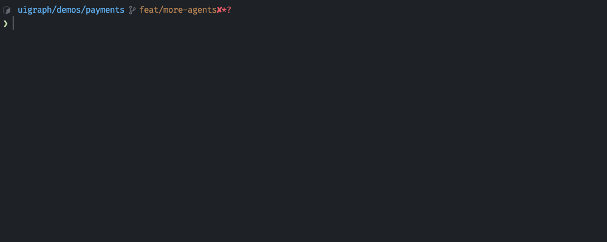
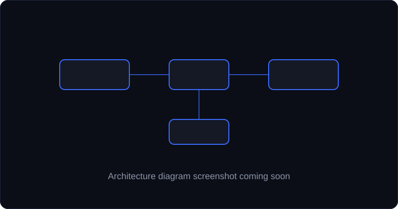

<p align="center">
  
</p>
<h1 align="center">UIGraph</h1>
<h3 align="center">The engineering map of your codebase.</h3>

<p align="center">
  <a href="#install"><strong>Install</strong></a> &nbsp;·&nbsp;
  <a href="#quick-start"><strong>Quick start</strong></a> &nbsp;·&nbsp;
  <a href="#use-the-uigraph-skill"><strong>Skill</strong></a> &nbsp;·&nbsp;
  <a href="#architecture-diagrams"><strong>Diagrams</strong></a> &nbsp;·&nbsp;
  <a href="#commands"><strong>Commands</strong></a> &nbsp;·&nbsp;
  <a href="#lens"><strong>Lens</strong></a>
</p>

<p align="center">
  <a href="https://www.npmjs.com/package/uigraph"></a>
  <a href="https://www.npmjs.com/package/uigraph"></a>
  <a href="#install"></a>
  <a href="LICENSE"></a>
  <a href="https://github.com/uigraph-oss/uigraph"></a>
  <a href="#agents-and-sign-in"></a>
</p>

<p align="center">
  <a href="https://uigraph.app"></a>
  <a href="https://docs.uigraph.app"></a>
  <a href="https://console.uigraph.app"></a>
</p>

<p align="center">
  
</p>
<p align="center"><a href="docs/media/uigraph-demo.mp4">Watch the demo video</a></p>

Every service in your codebase, with its APIs, dependencies, databases and diagrams. Your coding agent writes them as plain files in your repo, and UIGraph shows them in a local viewer.

Works with Claude Code, Codex, OpenCode, Pi and Cursor. Free and open source.

## Why UIGraph

- **Lives in your repo.** Artifacts are plain files: `.uigraph.yaml`, Mermaid, OpenAPI and SQL. You version them, diff them and review them in pull requests.
- **Built from your code.** The agent writes only what it finds in your files, and you choose which diagrams and documents it creates.
- **Two-way.** Edit a diagram in the viewer and it is saved back to the file.
- **Reviews pull requests.** `uigraph lens` shows the flows a change touches, its impact, test coverage and rollout.
- **Your agent, your logins.** UIGraph uses the coding agent you already have.

## Install

```sh
npm install -g uigraph
```

Or run it without installing:

```sh
npx uigraph
```

Requires Node.js 20 or later.

## Quick start

Install the UIGraph skill in your coding agent once:

```sh
npx skills add uigraph-oss/skills
```

In your project, start the agent and ask it to generate the artifacts:

```
/uigraph Generate the UIGraph artifacts for this project
```

1. The agent explores the project.
2. It proposes diagrams and existing documents, and you pick the ones you want.
3. It writes the artifacts, adds them to the viewer and opens it.

The first time, it also adds a short `.uigraph/AGENTS.md`, so your agent keeps the artifacts up to date as the code changes. See [What UIGraph changes](#what-uigraph-changes).

To open the viewer again later, run UIGraph in the project:

```sh
cd your-project
uigraph
```

UIGraph starts the viewer at `http://127.0.0.1:8447/` and opens the browser. The viewer keeps running in the background after the command finishes. Run `uigraph stop` to stop it.

Moving to another project? Run `uigraph` there too. If the viewer is already running, UIGraph adds the project to it instead of starting a second viewer.

## Use the UIGraph skill

Ask for everything at once, as in [Quick start](#quick-start), or for one artifact at a time. The agent reads your code and writes `.uigraph.yaml` and files under `.uigraph/`.

| Artifact              | Example prompt                                                      | Written to                                                                |
| --------------------- | ------------------------------------------------------------------- | ------------------------------------------------------------------------- |
| Architecture diagrams | `/uigraph Create a sequence diagram of the checkout flow`           | `.uigraph/diagrams/`. See [Architecture diagrams](#architecture-diagrams) |
| API specs             | `/uigraph Create the API spec for this service`                     | `.uigraph/openapi/`. Existing specs are used where they are               |
| Database schemas      | `/uigraph Create the database schema from the migrations`           | `.uigraph/db/`                                                            |
| Saved queries         | `/uigraph Add the important queries against the orders database`    | `.uigraph/queries/`                                                       |
| Dependencies          | `/uigraph List the services and datastores this service depends on` | `.uigraph.yaml`                                                           |
| Docs                  | `/uigraph Document how to run and operate this service`             | `.uigraph/docs/`. Existing docs are used where they are                   |

The skill writes only what it finds in your files. It also creates maps when you ask for them, and cost tags and a timeline when your repo has the evidence for them.

### See them in the viewer

Running the skill, or `uigraph` in the project, adds the project to the viewer. After that, the viewer reads the files on every page load, so refresh the browser to see anything the agent writes later.

Diagram edits you make in the viewer are saved back to the same files, so the agent sees them the next time it runs.

## Architecture diagrams

<p align="center">
  
</p>

Ask your agent to draw how your system works, straight from the code:

```
/uigraph Create a system context diagram for this service
/uigraph Create a sequence diagram of the login flow
/uigraph Create a state diagram for the order status
/uigraph Create a diagram of the background jobs
/uigraph Create C4 container and component diagrams for this service
```

The agent reads your code, proposes diagrams, and you pick the ones you want. It draws only what it finds in your files.

| Diagram             | Shows                                                     | Type                          |
| ------------------- | --------------------------------------------------------- | ----------------------------- |
| System context      | The service, its datastores and every outbound dependency | Flowchart                     |
| Request or flow     | One important flow, such as login, checkout or ingestion  | Sequence diagram              |
| Background flow     | Workers, queues, scheduled jobs and webhook handlers      | Flowchart or sequence diagram |
| State machine       | An entity with a status and its transitions               | State diagram                 |
| Internal components | How the main modules call each other                      | Flowchart                     |
| Deployment          | Kubernetes or Terraform with several units                | Flowchart                     |

To keep diagrams current, ask your agent to update them after a change. The `.uigraph/AGENTS.md` that the skill adds on the first run tells agents to do this as they work.

## Commands

### `uigraph`

Starts the viewer, adds the project's artifacts to it, and opens the browser. If the project has no artifacts, the viewer still runs and shows your other projects.

| Option            | Effect                                         |
| ----------------- | ---------------------------------------------- |
| `--port <number>` | Viewer port. Default `8447`, or `UIGRAPH_PORT` |
| `--no-open`       | Do not open a browser                          |

### `uigraph sync`

Adds the project's existing artifacts to the viewer and exits. It does not start the viewer or generate anything. Use it to add a project that already has artifacts, for example from a script.

### Viewer: `start`, `status`, `stop`, `restart`

| Command           | Does                                                           |
| ----------------- | -------------------------------------------------------------- |
| `uigraph start`   | Start the viewer in this terminal                              |
| `uigraph status`  | Show whether the viewer is running and which projects it shows |
| `uigraph stop`    | Stop the viewer                                                |
| `uigraph restart` | Stop the running viewer and start a new one in this terminal   |

Each accepts `--port <number>`.

`uigraph` starts the viewer in the background. `uigraph start` and `uigraph restart` run it in the current terminal instead, and closing that terminal stops it.

### `uigraph lens`

Reviews a GitHub pull request, or the difference between two branches, to help you understand the change. See [Lens](#lens).

| Option              | Effect                                              |
| ------------------- | --------------------------------------------------- |
| `--base <branch>`   | Branch or commit to compare against                 |
| `--target <branch>` | Branch or commit to review                          |
| `--regenerate`      | Run a new review instead of reusing a completed one |
| `--agent <name>`    | Agent to use. Without it, UIGraph asks              |
| `--model <name>`    | Model to use, in the agent's own format             |
| `--port <number>`   | Viewer port                                         |
| `--no-open`         | Do not open a browser                               |

### Global options

- `--debug`: print stack traces for unexpected errors (or set `UIGRAPH_DEBUG=1`).
- `-v`, `--version`: print the version.

Run `uigraph <command> --help` for details.

## What UIGraph changes

**In your project**

- The UIGraph skill writes `.uigraph.yaml` and the files under `.uigraph/`.
- When the project has no artifacts yet, the skill also adds `.uigraph/AGENTS.md`. It tells agents such as Claude Code and Codex when and how to update the artifacts as they change the code. A short UIGraph section in `CLAUDE.md` and `AGENTS.md` points to it. If neither file exists, the skill creates `AGENTS.md`.
- Diagram edits in the viewer are saved back to the project's files. Services, APIs and dependencies are read-only in the viewer.
- Diagrams created on a service's Architecture tab are saved in that service's project.

**On your machine**

- `~/.uigraph/` holds your registered projects, the viewer log, Lens runs and settings, and diagrams created on the Diagrams page.
- The viewer listens on `127.0.0.1` only.

## Lens

Lens helps you understand a change before you approve it. For each review it shows:

- Before and after diagrams of the flows the change touches
- How the change compares with its issue, description and commits
- Values the code picked, such as limits and timeouts
- Other services the change affects
- Which new behavior has a test
- A safe order to ship, with checks before you deploy

Each step can be turned off. See [Customize](#customize).

### What to review

A pull request, in any of these forms:

```sh
uigraph lens https://github.com/owner/repo/pull/123
uigraph lens owner/repo#123
uigraph lens 123            # inside a clone whose origin is on GitHub
```

Or two branches in the current repository:

```sh
uigraph lens --base main --target feature/login
```

Lens reviews the commits on `--target` since it split from `--base`, the same changes a pull request would show. Uncommitted changes are not included. Branch reviews read your repository with git and do not use GitHub.

The review opens in the viewer. If no viewer is running, the command starts one in this terminal. Reviews are listed under Lens in the sidebar.

Every run is saved in `~/.uigraph/lens/runs`. A completed run for the same pull request, base and head commit is reused unless you pass `--regenerate`.

### GitHub access

Pull request reviews need a GitHub token. Branch reviews do not. Lens looks for one in this order:

1. `GITHUB_TOKEN`
2. `GH_TOKEN`
3. The token from `gh auth token`

The viewer process reads the token. It is not sent to the browser.

### Customize

Select **Customize** in a review to choose:

- a focus, for example "look for double charges"
- which review steps to run
- how many flow diagrams Lens draws (1 to 4)
- the agent and model for reviews started from the viewer

Lens saves these settings in `~/.uigraph/lens/settings.json`.

A repository can set the same options for everyone who reviews it, in a `.uigraph.lens.yml` file at its root:

```yaml
focus: |
  Payments code. Look for double charges and wrong refund amounts.
steps:
  impact: false
diagrams: 2
```

Lens reads this file from the base branch, so a pull request cannot change how it is reviewed. The repository focus is used together with your own focus. Steps and diagrams in the file replace your settings.

### Agents and sign-in

The skill runs inside your agent. Lens starts an agent itself, using your own login for the one you pick:

- **Claude Code:** your Claude login or `ANTHROPIC_API_KEY`. Set `CLAUDE_CONFIG_DIR` if your Claude settings live outside `~/.claude`.
- **Codex:** `codex login` or `CODEX_API_KEY`.
- **OpenCode:** provider keys such as `ANTHROPIC_API_KEY` or `OPENAI_API_KEY`. UIGraph bundles its own OpenCode with its own settings in `~/.uigraph/opencode`, so it ignores any OpenCode you have installed.
- **Pi:** `~/.pi/agent/auth.json` or provider keys such as `ANTHROPIC_API_KEY`.
- **Cursor:** `CURSOR_API_KEY`. Without `--model`, Cursor picks the model.

Lens sends the code it reviews to the agent's model provider.

## UIGraph Cloud and self-hosted

The local viewer is free. For shared catalogs, teams and roles, integrations, AI features and SSO, see [UIGraph Cloud](https://console.uigraph.app) or [self-host UIGraph](https://docs.uigraph.app/self-hosting). The Plans page in the viewer compares them.

## Learn more

- [Documentation](https://docs.uigraph.app)
- [Contributing](CONTRIBUTING.md)

## License

UIGraph is licensed under the [Apache License 2.0](LICENSE).
